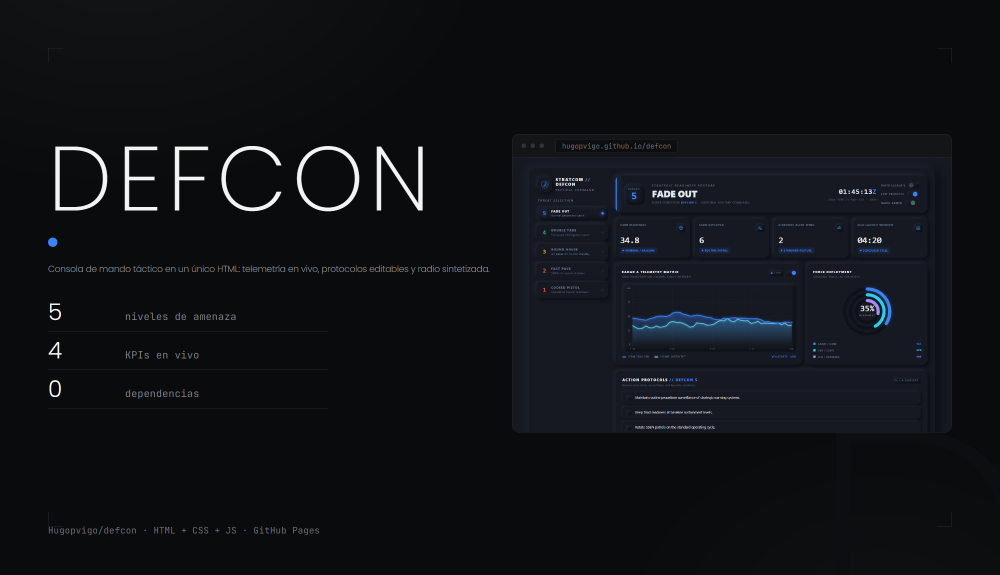
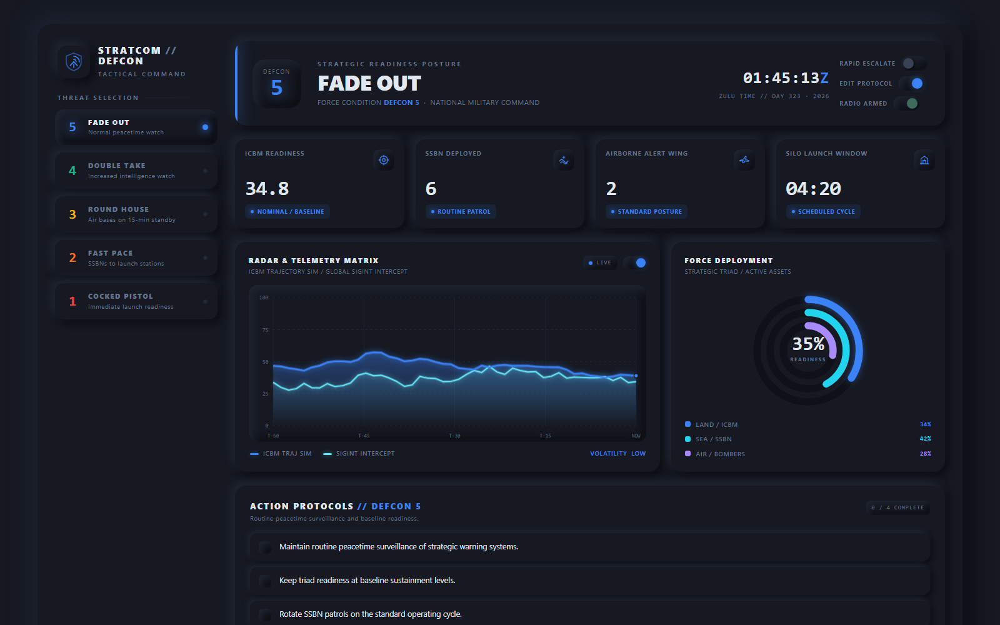

<meta property="og:title" content="DEFCON">
<meta property="og:description" content="Consola de mando táctico en un único HTML: telemetría en vivo, protocolos editables y radio sintetizada.">
<meta property="og:image" content="https://raw.githubusercontent.com/Hugopvigo/defcon/main/docs/capturas/og.png">

<p align="center">
  
</p>

<p align="center">
  
</p>

<p align="center">
  <b>Una consola de mando DEFCON que cabe en un solo archivo.</b><br>
  Cinco niveles de amenaza, telemetría en vivo, protocolos editables y radio sintetizada. Sin dependencias.
</p>

<p align="center">
  <a href="https://hugopvigo.github.io/defcon/"></a>
  
  
  
  
  
</p>

---

## Qué es esto

**DEFCON** es una consola de operaciones autocontenida: interfaz neumórfica oscura, telemetría SVG en vivo, panel de protocolos editable y audio de radio sintetizado. Todo el CSS y el JavaScript van en línea: **no hay fuentes, imágenes, librerías ni CDNs externos**.

> Proyecto de demostración. Los datos son simulados y no existe conexión con ningún sistema real.

## Características

- **Selector DEFCON 5 → 1**: cinco botones táctiles; el nivel activo queda hundido en un pozo con el color de amenaza correspondiente (azul, teal, amarillo, naranja, rojo).
- **Escalado dinámico**: al cambiar de nivel se recolorean los acentos, se animan los cuatro KPIs, se redibuja el donut de la tríada estratégica, aumenta la volatilidad de la telemetría y se sustituyen los protocolos. En DEFCON 1 la cabecera entra en estado de alerta pulsante.
- **Reloj Zulu**: hora UTC con día del año, actualizado cada segundo.
- **Telemetría en vivo**: gráfico SVG de doble serie (simulación de trayectorias ICBM e interceptos SIGINT) con gradientes, rejilla, leyenda y regeneración cada 2,5 s. Interruptor LIVE/HOLD.
- **Gauge de despliegue**: donut SVG de tres arcos (Land/ICBM, Sea/SSBN, Air/Bombers) con animación de `stroke-dasharray` y porcentaje central de preparación.
- **Protocolos editables**: checklist por nivel DEFCON, texto editable en línea, casillas de cumplimiento, borrado de directivas, añadir órdenes personalizadas y restaurar valores por defecto. Se guarda en `localStorage`.
- **Comunicaciones por radio**: audio de walkie-talkie generado con Web Audio API (estática tenue, clic de PTT, voz con formantes e ininteligible, squelch y pitido final). Se activa en el primer clic por la política de autoplay del navegador y se controla con el interruptor **RADIO COMMS**.
- **Diseño responsive**: a menos de 1000 px el raíl pasa a barra horizontal; a 760 px los KPIs pasan a 2×2 y los gráficos se apilan; a 480 px se compactan paddings y tipografía.
- **Accesibilidad y motion**: controles con `aria-*`, foco visible, scrollbars y selección tematizados, y respeto a `prefers-reduced-motion`.

## Uso

Abre `index.html` directamente en cualquier navegador moderno. No necesita servidor ni instalación.

Si prefieres servirlo localmente:

```bash
python -m http.server 8000
```

y visita `http://localhost:8000/`.

El audio requiere un gesto del usuario (clic o tecla) antes de comenzar, según las políticas de los navegadores.

## Publicar en GitHub Pages

El proyecto es estático y compatible con GitHub Pages sin ningún paso de compilación:

1. En el repo, entra en **Settings → Pages**.
2. En **Build and deployment**, selecciona **Deploy from a branch**.
3. Elige la rama `main` y la carpeta `/ (root)`, y guarda.
4. Espera unos segundos a que se complete el despliegue.

La URL será `https://hugopvigo.github.io/defcon/`.

Nota: en repositorios privados, GitHub Pages requiere un plan Pro/Team (o superior). En un repo público es gratuito.

## Estructura

```
.
├── index.html              # aplicación completa (HTML + CSS + JS + SVG)
├── docs/capturas/
│   ├── 00-cabecera.png     # cabecera del repo (GitHub-Design)
│   ├── 01-desktop.png      # captura real de la consola
│   └── og.png              # imagen social (1200×630)
├── LICENSE                 # CC BY-NC-SA 4.0
└── README.md               # este archivo
```

## Detalles técnicos

- Sin dependencias ni build: HTML5, CSS con variables personalizadas y JavaScript ES6 en línea.
- Las gráficas son SVG generado y animado desde JS; el donut usa transiciones de `stroke-dasharray`.
- El audio se sintetiza en tiempo real con `AudioContext`: fuente de sierra + ruido, banco de formantes, filtrado telefónico y saturación suave. No se reproduce ningún archivo de sonido.
- La persistencia de protocolos usa la clave `stratcom-defcon-protocols-v1` en `localStorage`.

## Aviso

Nombres, niveles y directivas son representaciones ficticias con fines de demostración visual. No deben interpretarse como procedimientos militares reales.

## Licencia

[Creative Commons Attribution-NonCommercial-ShareAlike 4.0 International](https://creativecommons.org/licenses/by-nc-sa/4.0/). Puedes compartir y adaptar el proyecto con fines no comerciales, citando a Hugo Perez-Vigo y manteniendo la misma licencia en las obras derivadas.

---

<p align="center">
  Desarrollado por <a href="https://github.com/Hugopvigo">Hugo Perez-Vigo</a> · <a href="https://hugoperezvigo.es">hugoperezvigo.es</a>
</p>
